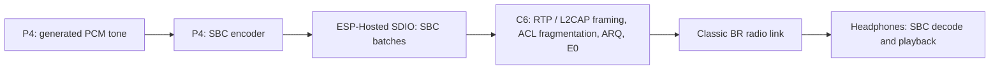

# Native Bluetooth Classic A2DP on M5Stack Tab5

A minimal touchscreen proof of concept that streams audio from the Tab5 to
ordinary Bluetooth Classic headphones or speakers using only its ESP32-P4 and
ESP32-C6. The P4 creates a tone and encodes it as SBC; custom C6 firmware
transmits the Classic radio packets. No external Bluetooth adapter or computer
audio relay is needed to run the demo. A2DP (Advanced Audio Distribution
Profile) is the audio profile used here.

## How Bluetooth Classic is achieved

The P4 has no Bluetooth radio, and the C6's normal Bluetooth controller is BLE
only. This project implements an experimental Classic BR link by repurposing the
C6 radio through custom firmware; it does not enable a stock Classic controller
or use ESP-IDF's normal Bluedroid A2DP API.

The work is split between the processors:

| Processor / layer | Responsibility |
| --- | --- |
| P4 application | Touchscreen UI, USB console, tone generation, saved peer and bond, bounded reconnect |
| P4 Classic host | Discovery orchestration, LMP, SSP Just Works pairing, authentication, encryption setup, L2CAP and AVDTP source negotiation |
| P4 codec | Encode interleaved stereo PCM into SBC frames |
| ESP-Hosted SDIO | Carry vendor HCI commands, replies and SBC batches between P4 and C6 |
| Custom C6 firmware | Inquiry/page radio work, slot timing, hopping, Classic packet handling, ARQ retransmission, E0 encryption and media transmission |

The C6 firmware hooks selected routines in ESP-IDF's BLE controller library and
uses Direct Test Mode (DTM) radio framing as the basis for Classic BR packets.
Software supplies Classic access codes, packet headers, whitening, error coding,
hopping and link behavior. Time-critical work runs on the C6; the P4 controls it
through the custom `0xFFE0` vendor HCI command protocol (`BRL1`). These commands
remain named "radio lab" in the source because the working link grew out of the
radio experiments.

Pairing establishes a link key, saved in the P4's `a2dpn` NVS namespace.
Subsequent connections authenticate with that key and establish E0 encryption.
The host opens or accepts the L2CAP AVDTP signaling channel, negotiates SBC
capabilities, then opens and starts the media stream.

Three details make this work with ordinary headphones, not just one test speaker:

- **Paging any address.** The C6 sends each Classic packet as a BLE DTM frame. The
  page response (FHS) originally carried the peer's sync word in the BLE header,
  so the frame length was whatever the peer's address dictated; only about one
  address in six could be paged. Since C6 1.4.253 the whole BR packet follows a
  BLE header the firmware chooses (`page shift`), so every address works.
- **Classic modulation index.** BLE transmits with a modulation index of about
  0.5; Bluetooth Classic specifies 0.28-0.35, and some receivers (a Sennheiser
  HDB 630 here) lose about 1.5 % of payload bits at 0.5 and reject almost every
  audio packet. During a Classic session the P4 sets two C6 baseband TX
  registers: `0x600A200C` bits 8-11 (a signed deviation trim, -8) and
  `0x600A20EC` bits 24-31 (TX filter gain, 0x40 instead of 0xEC). That gives a
  clean GFSK waveform at h = 0.33 (measured with a HackRF) with the carrier
  unchanged; the BLE values are restored when the session ends. `a2dp brmod 0`
  turns it off for comparison.
- **Spec behaviour sinks rely on.** The host serves an SDP record for the A2DP
  Source (some sinks refuse to open AVDTP without it), tries every audio sink
  endpoint until one offers SBC (sinks often list AAC or vendor codecs first),
  accepts a sink's smaller encryption key size (7-16 bytes), answers
  GET_CONFIGURATION, and restarts the stream after a sink SUSPEND.

## How A2DP audio is achieved



The P4 host negotiates the SBC stream's sample rate and codec configuration over
AVDTP. The encoder produces SBC frames and sends them to the C6's stream ring in
batches. The C6 adds A2DP media framing and transmits fragments over the
encrypted Classic link. The receiving device decodes SBC using its ordinary A2DP
sink. `a2dp tone 440` exercises this complete P4-to-headphones path.

An application can replace the tone with its own PCM producer: wait for
`a2dp_native::ready()`, obtain `rate()`, then feed interleaved stereo int16
samples to `write_pcm()`. The bounded PCM queue applies backpressure. Turn the
internal tone off before feeding external PCM.

## Hardware and software

- M5Stack Tab5 with a pre-v3 ESP32-P4 and onboard ESP32-C6. The build defaults
  support P4 revisions 0.x and 1.x; revision 3.x requires a separate build
  configuration.
- ESP-IDF **5.5.5**, target `esp32p4` for the demo.
- Ordinary Bluetooth Classic A2DP headphones or speaker.
- C6 running the custom **1.4.264** image in `firmware/network_adapter.bin`,
  installed and confirmed before launching the P4 demo. Stock Tab5 C6 firmware
  cannot run this implementation. See [C6 firmware](firmware/README.md).

The project configuration supplies the Tab5 wiring: SDIO slot 1, four-bit bus at
40 MHz, CMD 13, CLK 12, D0 11, D1 10, D2 9, D3 8, active-low C6 reset on GPIO
15. The BSP powers the C6 rail through the board's I/O expander. PSRAM and a 1
kHz FreeRTOS tick are enabled.

## Flash the prebuilt firmware

`firmware/p4/` holds a ready-to-flash build of this demo (ESP-IDF 5.5.5,
`esp32p4`, P4 revisions 0.x/1.x). Verify it from `firmware/` with
`shasum -a 256 -c SHA256SUMS`, close other serial monitors, then, from
`firmware/p4/`:

```sh
python -m esptool --chip esp32p4 -p /dev/cu.usbmodem1101 -b 460800 \
  --before default_reset --after hard_reset write_flash "@flash_args"
```

This writes the bootloader, partition table, OTA data and application and
keeps the `a2dpn` NVS data (saved peer and bond). For a fresh board,
`tab5_a2dp_demo_merged.bin` is the same build as one image written at offset
`0x0`; because it spans the NVS partition it **erases any saved bond**:

```sh
python -m esptool --chip esp32p4 -p /dev/cu.usbmodem1101 -b 460800 \
  write_flash 0x0 tab5_a2dp_demo_merged.bin
```

Either way the C6 needs the matching 1.4.264 image (see
[C6 firmware](firmware/README.md)); the P4 images do not install it.

## Build and run

After installing and activating ESP-IDF 5.5.5, run from the project root:

```sh
idf.py -DIDF_TARGET=esp32p4 build
idf.py -p /dev/cu.usbmodem1101 flash monitor
```

Replace the port as needed and close other serial monitors or serial bridges.
The component manager downloads the pinned BSP, Wi-Fi Remote and their normal
transitive dependencies. Keep the vendored patched ESP-Hosted component: the
stock component cannot substitute for its raw HCI transport.

The screen shows the live A2DP state, saved headphones, search results and
test-tone controls in landscape orientation. The USB Serial/JTAG console remains
available. Flashing installs the P4 application; it does not install the C6
image. Pairing data is stored in the `a2dpn` NVS namespace. Reflashing with the
supplied partition layout preserves that data unless flash is erased.

## Touchscreen controls

- **Find devices** searches for discoverable devices for up to 40 seconds. Put
  your headphones in pairing mode first. Results appear as they are found, audio
  devices first, labelled by device class (headphones, headset, speaker...).
- **Tap a found device** to pair it. During a search it pairs as soon as the
  current search window ends. A device is saved only once pairing succeeds, so
  a failed attempt does not touch the other saved devices.
- **Tap a saved device** to connect it. Up to eight paired devices are kept,
  most recently used first, with the name each device reports.
- **Connect** reconnects the default (most recently used) saved device.
- **Disconnect** stops the tone and cleanly detaches the link; it also cancels a
  search or connection attempt.
- **Play 440 Hz tone / Stop tone** controls audio once streaming is established.

Controls are disabled when their action is unavailable. Radio operations run
outside the LVGL task, so the display and touch remain responsive during paging
and discovery. The screen appears before the radio starts and reports transport
startup errors.

## Demonstrate the feature from USB

Turn the headphones down and place your chosen device in pairing mode:

```text
a2dp find
a2dp list
```

`a2dp list` prints the saved devices and the last search's results with an index.
Pair one by index or address (most significant byte first, colons optional):

```text
a2dp pair 0
```

Wait for streaming, then:

```text
a2dp tone 440
a2dp status
```

You should hear the tone; status shows the connection, the SBC frame counter and
the current bitpool. End with:

```text
a2dp tone off
a2dp stop
```

On later runs, `a2dp connect` connects the default saved device and
`a2dp connect <n>` a specific one from `a2dp list`; `a2dp forget <n>` removes one.
`a2dp auto 1` enables bounded reconnect to the default device, including after
boot; `a2dp auto 0` disables it. Always stop the link and wait for detach before
resetting or reflashing: silent link loss can make a receiver temporarily refuse
another connection (the host retries a "connection already exists" refusal after
12 seconds).

After streaming starts, the P4 measures missed replies for two seconds and
reconnects when more than 12 % are missed, up to three times (about six seconds
of silence each). Some receivers share their radio with their own BLE links, and
each connection lands at a random timing offset to them; a fresh connection
usually avoids a bad offset. `a2dp qmax <pct>` changes the threshold (-1 forces
the retries for testing); `a2dp lateskip`, `a2dp connls44` and `a2dp rxearly` are
radio tuning controls that apply to the next connection.

A link can also drift into a bad phase minutes after it started, so the stream
adapts continuously: each second, more than 15 % missed replies or a full C6
frame ring lowers the SBC bitpool by two (14, 12, 10, 8); five clean seconds
raise it again. Audio quality drops during a bad phase instead of breaking up.
The connection receive window (`ls44` 700) ends early enough that a missed
reply costs one radio slot instead of two.

Diagnostics: `a2dp diag` prints the link counters (missed replies, retransmits,
acknowledgements and the sink's reply headers), `a2dp chans` the missed replies
per RF channel (interference shows up as a block of bad channels). The
convenience command `a2dp pair` with no argument discovers and pairs the first
audio device it finds. `a2dp connect beep` loops the C6's built-in SBC beep for
diagnostics; the P4 tone demonstrates the full PCM and encoder path.

## Source layout

| Path | Purpose |
| --- | --- |
| `main/main.cpp` | Startup, UI command queue and USB console |
| `main/ui.*` | LVGL touchscreen, device list and tone control |
| `main/bt/a2dp_native.*` | P4 A2DP host, saved devices, reconnect, PCM queue, SBC and BR modulation |
| `main/bt/radio_lab.*` | Vendor HCI protocol adapter |
| `main/bt/bt_owner.*` | Raw HCI controller ownership |
| `components/br_baseband/` | Classic protocol, crypto and baseband helpers |
| `components/sbc_enc/` | SBC encoder from ESP-IDF |
| `components/espressif__esp_hosted/` | Patched P4 SDIO and HCI transport |
| `c6_fw/c6_firmware/` | C6 controller hooks and Classic radio implementation |
| `c6_fw/cis_ll/` | Supporting engine used by the C6 firmware |
| `firmware/` | Matching C6 image, prebuilt P4 images (`p4/`), checksums and provenance |

The P4 demo starts the display and touch. The BSP brings its usual transitive
build dependencies. The C6 firmware also includes LE Audio support and an update
guard; Classic mode takes exclusive ownership of the radio.

## Current limits and validation

**2026-11-11, C6 1.4.253-1.4.264 update.** Developed and measured in the parent
Tab5 firmware (same host, baseband and C6 code as this repository) with a
Sennheiser HDB 630, which the earlier code could neither page (its address gave
a 217-byte FHS frame) nor stream to:

- Search finds it within 5 s; paging takes 0.5-3.6 s, then SSP pairing,
  encryption, the SDP lookup and the endpoint walk (SBC is its fourth endpoint).
- Before the modulation change it acknowledged 3 % of audio fragments (bitpool
  fell to 8 with dropped frames, audibly almost silent). With the Classic
  modulation index: 92 % acknowledged, 99.9 % of its replies ACK, missed replies
  8-9 % (was about 30 %), bitpool steady at 14 and no SBC frames dropped in a
  60-second run.
- Not re-tested with these changes: the Galaxy Projector Speaker and Bose
  headphones from the earlier validation, and this demo's own P4 build on
  hardware. The prebuilt C6 image is the one installed and confirmed on the
  development Tab5; the P4 images are a clean build of this repository.

**2026-11-10, C6 1.4.247-1.4.252 update.** The radio changes (long-FHS paging,
late-hook slot skip, FHS-anchored slot grid), the link-quality reconnect and the
adaptive bitpool were
developed and measured in the parent Tab5 firmware on a Galaxy Projector Speaker
(LAP `E91187`, length byte 70): page in 0.1-3.5 s, SSP pairing, encrypted
streaming; ten consecutive connections at 1-8 % missed replies with no dropped
SBC frames, and three forced quality retries that reconnected cleanly. Before the
slot-skip fix about half of all connections ran at 25-40 % missed replies with
audible breakup, and bad phases also began mid-link. With 1.4.252 and the
adaptive bitpool, a 5.3-minute soak that included four minutes at about 41 %
missed replies (bitpool 8) dropped no SBC frames; the bitpool returned to 14 in
a clean stretch. The prebuilt images in `firmware/` are the shipped C6 image that
was installed and confirmed on that Tab5, and a clean P4 build of this demo. This
demo's own P4 build has not yet been flashed and run on hardware, and the Bose
headphones used for the earlier work have not been retested with 1.4.252.

**Earlier validation.**

The touchscreen POC was flashed to a Tab5 with P4 revision 1.3 on 2026-11-10.
Boot logs confirm a 1280 x 720 landscape display, ST712x touch initialization,
and a 75% backlight. The C6 SDIO transport and USB console respond, and the
saved bond is retained. A saved-bond connection test timed out without a
receiver response; audible playback from this POC remains unverified. Physical
touch interaction has not been manually verified.

The P4 application built successfully with ESP-IDF 5.5.5 in a clean build
directory, resolving board dependencies through the component registry. The
bundled C6 source also built successfully in isolation; its controller hook
checker reports `RESULT: PASS`, and the guard and CIS host tests pass.

This is an experimental BR-only implementation using one-slot packets, a low SBC
bitpool (8-14 for streaming, adapted to the link; advertised maximum 20), and a fixed local identity
chosen to fit the DTM framing constraints. Multi-slot DH3/DH5, EDR, adaptive
frequency hopping, AVRCP (remote control and absolute volume), legacy PIN pairing
(pre-2.1 devices) and role switch are not implemented; incoming AVCTP is refused.
Reconnect after a real range loss remains unverified. Wi-Fi and BLE are unavailable while Classic mode owns the C6 radio.
It is a proof of concept, not a qualified Bluetooth product.

## Attribution

The C6 work builds on Ernest Domaradzki's
[esp32-p4-c6-le-audio](https://github.com/ernimen7/esp32-p4-c6-le-audio).
Vendored ESP-Hosted and SBC code retain their original license headers and
notices. See [THIRD_PARTY.md](THIRD_PARTY.md), the component license files and
[C6 notices](c6_fw/NOTICE). Upstream licenses cover their respective files; no
blanket license is assigned to this project.
