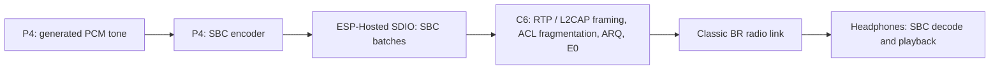

# Native Bluetooth Classic A2DP on M5Stack Tab5

A minimal proof of concept that streams audio from the Tab5 to
ordinary Bluetooth Classic headphones or speakers using only its ESP32-P4 and
ESP32-C6. The P4 creates a tone and encodes it as SBC; custom C6 firmware
transmits the Classic it as bluetooth classic over A2DP. 

## How Bluetooth Classic is achieved

The P4 has no Bluetooth radio, and the C6's normal Bluetooth controller is BLE
only. This project implements an experimental Classic BR link by repurposing the
C6 radio through custom firmware.

The work is split between the processors:

| Processor / layer | Responsibility |
| --- | --- |
| P4 application | Touchscreen UI, USB console, tone generation, saved peer and bond, bounded reconnect |
| P4 Classic host | Discovery orchestration, LMP, SSP Just Works pairing, authentication, encryption setup, L2CAP and AVDTP source negotiation |
| P4 codec | Encode interleaved stereo PCM into SBC frames |
| ESP-Hosted SDIO | Carry vendor HCI commands, replies and SBC batches between P4 and C6 |
| Custom C6 firmware | Inquiry/page radio work, slot timing, hopping, Classic packet handling, ARQ retransmission, E0 encryption and media transmission |

The C6 firmware hooks selected routines in ESP-IDF's BLE controller library and
uses Direct Test Mode (DTM) radio framing as the basis for Classic BR packets.
Software supplies Classic access codes, packet headers, whitening, error coding,
hopping and link behavior. Time-critical work runs on the C6; the P4 controls it
through the custom `0xFFE0` vendor HCI command protocol (`BRL1`). These commands
remain named "radio lab" in the source because the working link grew out of the
radio experiments.

Pairing establishes a link key, saved in the P4's `a2dpn` NVS namespace.
Subsequent connections authenticate with that key and establish E0 encryption.
The host opens or accepts the L2CAP AVDTP signaling channel, negotiates SBC
capabilities, then opens and starts the media stream.

## How A2DP audio is achieved



The P4 host negotiates the SBC stream's sample rate and codec configuration over
AVDTP. The encoder produces SBC frames and sends them to the C6's stream ring in
batches. The C6 adds A2DP media framing and transmits fragments over the
encrypted Classic link. The receiving device decodes SBC using its ordinary A2DP
sink. `a2dp tone 440` exercises this complete P4-to-headphones path.

### Sample rate

Each saved device has a learned rate, stored with its bond in NVS. A device
starts from a first guess: 48 kHz for Sennheiser addresses (OUI `80:C3:BA`),
44.1 kHz for everything else. Two media stalls at one rate while audio is
playing switch the device to the other rate; the host ends the link and
reconnects at the new rate at once, and the tone carries on. 

`a2dp rates` lists each saved device's learned rate and stall count; `a2dp rates
clear` resets them. `a2dp rate48 0` or `1` fixes the rate at 44.1 or 48 kHz for
testing and turns learning off; `a2dp rate48 auto` turns it back on. The logic
is in `main/bt/a2dp_rate.h`, with host tests in `tests/br/a2dp_rate_test.cpp`.

An application can replace the tone with its own PCM producer: wait for
`a2dp_native::ready()`, obtain `rate()`, then feed interleaved stereo int16
samples to `write_pcm()`. The bounded PCM queue applies backpressure. Turn the
internal tone off before feeding external PCM.

## Hardware and software

- M5Stack Tab5 with a pre-v3 ESP32-P4 and onboard ESP32-C6. The build defaults
  support P4 revisions 0.x and 1.x; revision 3.x requires a separate build
  configuration.
- ESP-IDF **5.5.5**, target `esp32p4` for the demo.
- Ordinary Bluetooth Classic A2DP headphones or speaker.
- C6 running the custom **1.4.266** image in `firmware/network_adapter.bin`,
  installed and confirmed before launching the P4 demo. Stock Tab5 C6 firmware
  cannot run this implementation. See [C6 firmware](firmware/README.md).

## Flash the prebuilt firmware

`firmware/p4/` holds a ready-to-flash build of this demo (ESP-IDF 5.5.5,
`esp32p4`, P4 revisions 0.x/1.x). Verify it from `firmware/` with
`shasum -a 256 -c SHA256SUMS`, close other serial monitors, then, from
`firmware/p4/`:

```sh
python -m esptool --chip esp32p4 -p /dev/cu.usbmodem1101 -b 460800 \
  --before default_reset --after hard_reset write_flash "@flash_args"
```

This writes the bootloader, partition table, OTA data and application and
keeps the `a2dpn` NVS data (saved peer and bond). For a fresh board,
`tab5_a2dp_demo_merged.bin` is the same build as one image written at offset
`0x0`; because it spans the NVS partition it **erases any saved bond**:

```sh
python -m esptool --chip esp32p4 -p /dev/cu.usbmodem1101 -b 460800 \
  write_flash 0x0 tab5_a2dp_demo_merged.bin
```

Either way the C6 needs the matching 1.4.266 image (see
[C6 firmware](firmware/README.md)); the P4 images do not install it.

## Build and run

After installing and activating ESP-IDF 5.5.5, run from the project root:

```sh
idf.py -DIDF_TARGET=esp32p4 build
idf.py -p /dev/cu.usbmodem1101 flash monitor
```

Replace the port as needed and close other serial monitors or serial bridges.
The component manager downloads the pinned BSP, Wi-Fi Remote and their normal
transitive dependencies. Keep the vendored patched ESP-Hosted component: the
stock component cannot substitute for its raw HCI transport.

The screen shows the live A2DP state, saved headphones, search results and
test-tone controls in landscape orientation. The USB Serial/JTAG console remains
available. Flashing installs the P4 application; it does not install the C6
image. Pairing data is stored in the `a2dpn` NVS namespace. Reflashing with the
supplied partition layout preserves that data unless flash is erased.

## Touchscreen controls

- **Find devices** searches for discoverable devices for up to 40 seconds. Put
  your headphones in pairing mode first. Results appear as they are found, audio
  devices first, labelled by device class (headphones, headset, speaker...).
- **Tap a found device** to pair it. During a search it pairs as soon as the
  current search window ends. A device is saved only once pairing succeeds, so
  a failed attempt does not touch the other saved devices.
- **Tap a saved device** to connect it. Up to eight paired devices are kept,
  most recently used first, with the name each device reports.
- **Connect** reconnects the default (most recently used) saved device.
- **Disconnect** stops the tone and cleanly detaches the link; it also cancels a
  search or connection attempt.
- **Play 440 Hz tone / Stop tone** controls audio once streaming is established.

## Demonstrate the feature from USB

Turn the headphones down and place your chosen device in pairing mode:

```text
a2dp find
a2dp list
```

`a2dp list` prints the saved devices and the last search's results with an index.
Pair one by index or address (most significant byte first, colons optional):

```text
a2dp pair 0
```

Wait for streaming, then:

```text
a2dp tone 440
a2dp status
```

You should hear the tone; status shows the connection, the SBC frame counter and
the current bitpool. With no audio for three seconds the host suspends the
stream (AVDTP SUSPEND) and the link stays up; `a2dp tone 440` or the Play tone
button starts it again. End with:

```text
a2dp tone off
a2dp stop
```


## Source layout

| Path | Purpose |
| --- | --- |
| `main/main.cpp` | Startup, UI command queue and USB console |
| `main/ui.*` | LVGL touchscreen, device list and tone control |
| `main/bt/a2dp_native.*` | P4 A2DP host, saved devices, reconnect, PCM queue, SBC and BR modulation |
| `main/bt/a2dp_rate.h` | Per-device SBC sample-rate learning |
| `main/bt/radio_lab.*` | Vendor HCI protocol adapter |
| `main/bt/bt_owner.*` | Raw HCI controller ownership |
| `components/br_baseband/` | Classic protocol, crypto and baseband helpers |
| `components/sbc_enc/` | SBC encoder from ESP-IDF |
| `components/espressif__esp_hosted/` | Patched P4 SDIO and HCI transport |
| `c6_fw/c6_firmware/` | C6 controller hooks and Classic radio implementation |
| `c6_fw/cis_ll/` | Supporting engine used by the C6 firmware |
| `firmware/` | Matching C6 image, prebuilt P4 images (`p4/`), checksums and provenance |

The P4 demo starts the display and touch. The BSP brings its usual transitive
build dependencies. The C6 firmware also includes LE Audio support and an update
guard; Classic mode takes exclusive ownership of the radio.

## Current limits and validation

The standalone build also includes the legacy ESP-Hosted C6 target symbol needed
by the pinned Wi-Fi Remote dependency.

Host regression checks can be run from the repository root:

```sh
sh tests/run_host_tests.sh
sh c6_fw/c6_firmware/test/run_host_tests.sh
sh c6_fw/cis_ll/test/run.sh
```

This is a proof of concept, not a qualified Bluetooth product.

## Attribution

The C6 work builds on Ernest Domaradzki's
[esp32-p4-c6-le-audio](https://github.com/ernimen7/esp32-p4-c6-le-audio).
Vendored ESP-Hosted and SBC code retain their original license headers and
notices. See [THIRD_PARTY.md](THIRD_PARTY.md), the component license files and
[C6 notices](c6_fw/NOTICE). Upstream licenses cover their respective files; no
blanket license is assigned to this project.
